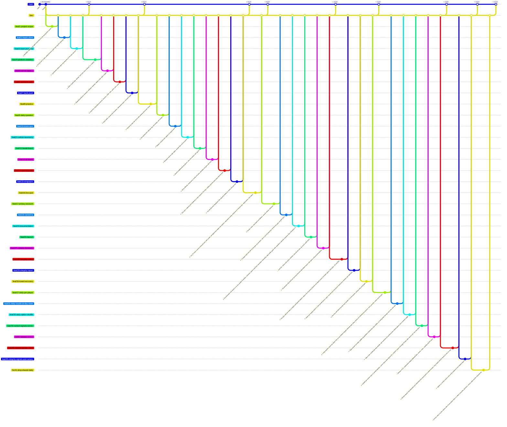

<!--
  Auto-generated from .github/roadmap.yaml by
  .github/scripts/render_roadmap.py. Do not edit this file directly —
  changes will be overwritten the next time it is rendered (in each
  release pull request). Edit the YAML or close / reopen a tracking issue
  instead.
-->

# IFS-Tests roadmap

Plan for the team's Formula Student quiz training platform. Each phase
is a cluster of feat branches cut from `dev`; a milestone tag on `main`
closes the phase once every branch in it has merged. Branch status
badges (✅ / 🔄 / 🔜 / ⏸) are derived from each branch's tracking issue
state in GitHub Issues.

Phase 1 is the groundwork (FS-Quiz mirror, proposal). Phases 2–4 build
the web app on the team's own server: invite + password accounts,
practice, mock quizzes, a daily question and a leaderboard. The design
is in `docs/architecture.md` and `docs/adr/`. Phase 5 is the launch;
phase 6 collects deferred ideas; phases 7–10 are the fair-play rules and
the season-1b mechanics (ADR 0010).

## Phase summary

| Phase | Title | Branches | Milestone tag |
|:---:|---|---|---|
| 1 | Foundations | ✅ done `feat/1-project-scope` · ✅ done `feat/2-fsquiz-client` · ✅ done `feat/3-team-proposal` | `v0.1.0` |
| 2 | Platform foundation Staging live on the team server, accounts and the question bank in place | ✅ done `feat/4-platform-skeleton` · ✅ done `feat/5-server-deploy` · ✅ done `feat/6-accounts-auth` · ✅ done `feat/7-bank-push` | `v0.2.0` |
| 3 | Training MVP One branch per way of answering questions, then the tools around them | ✅ done `feat/8-practice` · ✅ done `feat/9-daily-question` · ✅ done `feat/10-mock-quiz` · ✅ done `feat/11-admin-taxonomy` · ✅ done `feat/12-leaderboard` · ✅ done `feat/13-xp-levels` · ✅ done `feat/14-learning-aids` · ✅ done `feat/15-mingoquiz` | `v0.3.0` |
| 4 | Team play Live quiz sessions for team meetings and vertical training (ADR 0005) | ✅ done `feat/16-live-quiz` | `v0.4.0` |
| 5 | Launch | ✅ done `feat/17-privacy-account` · ✅ done `feat/18-ranked-lp` · ✅ done `feat/19-documentation` · 🔄 active `feat/20-launch` · ✅ done `feat/21-release-decisions` | `v1.0.0` |
| 6 | After launch _(deferred)_ Ideas to prioritise with the team once the MVP is in use | ⏸ deferred `feat/22-admin-totp` · ⏸ deferred `feat/23-notion-sync` · ⏸ deferred `feat/24-solution-bounty` · ⏸ deferred `feat/25-team-questions` · ⏸ deferred `feat/26-rule-page-links` · ⏸ deferred `feat/36-rank-open-questions` | `v1.1.0` |
| 7 | Fair play Ships in v2.0.0. ADR 0010: the rules per mode in English and Spanish, honest boards and read-only forensics. Branch numbers 28–35 and fix/41 were assigned by the plan; 22–26 and 36 stay in phase 6 for the deferred ideas; 27 moved to phase 8 | ✅ done `feat/28-fair-play-policy` · ✅ done `feat/29-integrity-report` · ✅ done `feat/30-board-accuracy` | `v2.0.0` |
| 8 | Season 1b Season 1b ships as the single release v2.0.0, deployed dark: a per-player daily with results at day close, option shuffle, and the server side of the announced per-answer totals (phases 7 and 9 land in it too). One switch, IFS_RULES_1B_FROM (26 October 2026, Madrid), turns them all on at one Madrid midnight; IFS_CANARY stays off until the recall pilot (ADR 0010) | ✅ done `feat/27-daily-per-player` · ✅ done `feat/31-daily-results-at-day-close` · ✅ done `feat/32-daily-option-shuffle` · ✅ done `feat/33-ranked-signals-server` · 🔜 planned `fix/40-release-v2.0.0` | `v2.0.0` |
| 9 | Signals Ships in v2.0.0 with phase 8, from the same switch: the client sends the totals the notice already names, from a Madrid midnight set at deploy, and the report reads them | ✅ done `feat/34-ranked-signals-client` · ✅ done `feat/35-integrity-signals-and-canary` | `v2.0.0` |
| 10 | Contract v2.1: after v2.0.0 has run in prod with the per-player daily in effect, the shared daily goes (the contract step) | 🔜 planned `fix/41-drop-shared-daily` | `v2.1.0` |

## Branch diagram

---

## How this file is maintained

- **Source of truth**: [`.github/roadmap.yaml`](.github/roadmap.yaml)
- **Renderer**: [`.github/scripts/render_roadmap.py`](.github/scripts/render_roadmap.py)
- **Workflow**: [`.github/workflows/roadmap.yml`](.github/workflows/roadmap.yml)

This file is refreshed in each release pull request (`docs/runbook.md`,
section 2.1), so between releases its status badges can lag. The
workflow runs on every push to `dev` and says in its summary whether this
file is stale; it never commits.
