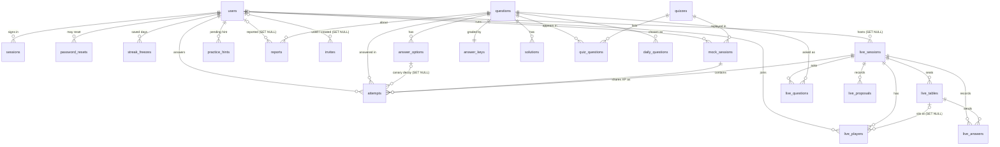

# Data model

Every table in the PostgreSQL database, what it holds, how it links to the others and which tables hold personal data. The source of truth is `src/ifs_tests/db/models.py`; the schema is built by the Alembic migrations in `migrations/versions/`. How the tables are used at run time (locks, jobs, answer secrecy) is in [architecture.md](architecture.md); the scoring the numbers feed is in [game-rules.md](game-rules.md).

Conventions:

- Times are `timestamp with time zone`, stored in UTC; "Madrid day" dates (`date` columns) are computed with `domain/daily.madrid_day`.
- Enumerations are strings with a `CHECK` constraint generated from a Python tuple in `models.py` (`ROLES`, `STATUSES`, `VERTICALS`, `POSITIONS`, `AREAS`, `KINDS`, `MODES`, `LIVE_STATES`). Widening one needs a migration.
- Constraint and index names follow the naming convention at the top of `models.py` (`pk_<table>`, `fk_<table>_<column>_<referred table>`, `ix_…`, `uq_…`, `ck_<table>_<name>`).
- **Watch the XP column name on `users`:** the ORM attribute `User.xp` maps to the column `account_xp`. The old column `users.xp` was dropped in 0024.

## Entity relationships

The main tables. Bank join tables (`quiz_events`, `quiz_documents`), `settings` and `audit_log` are left out for readability.

## Accounts

### `users`

One row per member. **Personal data.**

| Column | Meaning |
|---|---|
| `id` | Identity primary key |
| `email` | Login identifier, lower-case (`CHECK email = lower(email)`), unique; shown to admins only. Only an admin can change it (audited as `user.email`, without the addresses) |
| `password_hash` | Argon2id hash (`auth/passwords.py`); never in any response |
| `display_name` | 2–24 characters, Latin letters, digits, `. ' -`; unique on `lower(display_name)` (index `uq_users_display_name_lower`); look-alikes are also refused in code by comparing skeletons (`domain/accounts.name_skeleton`) |
| `vertical` | One of `Management`, `Mechanical`, `Tractive System`, `Electronics`, `Driverless`, `Business`, `Board`, or null |
| `role` | `member`, `reviewer` or `admin` (what they may do in the app) |
| `status` | `active`, `alumni` or `disabled`; only active accounts can sign in or appear on boards |
| `position` | Job on the team: `mingo`, `member` (returning member), `department_head`, `technical_director`. Sets the rank placement; Technical Directors may host live quizzes |
| `leaderboard_opt_out` | Hidden from other people's boards |
| `failed_logins`, `locked_until` | Consecutive failed password checks; lock end after the fifth (15 minutes) |
| `last_seen`, `created_at` | Last request (touched at most every 5 minutes) and sign-up time |
| `account_xp` (attribute `xp`) | Account XP, integer, only goes up; sets the account level |
| `rank_points` | Rank, `numeric(8,2)`: 100 points per division, 0 = Mingo I, 1500+ = the top title; floor 0 |
| `rank_season` | Season (start year) the rank belongs to; 0 = placed by the migration, no reset due |
| `rank_best` | Highest division reached this season (only a new one plays the promotion) |
| `position_lifts` | `jsonb`, null until an admin changes their position: `{"season": 2026, "member": 220.0, …}`, the LP each raise gave per position crossed that season, which a lower position takes back ([game rules](game-rules.md#24-placement-by-position)); ignored once the season is over |
| `combo`, `miss_streak` | Right answers in a row (XP combo) and wrong ones in a row (LP cushion); capped at 99 |
| `rested_xp`, `rested_on` | Banked rested XP and the Madrid day it was last topped up |
| `streak_freezes`, `freeze_earned_on` | Streak freezes held (0–2) and the streak day that last earned one |
| `subdepartments` | Team Directory department codes (`domain/live.SUBDEPARTMENTS`), `varchar(8)[]`; the first seats them in live quizzes |
| `left_at` | When they became alumni or disabled; the account is deleted 365 days later. Cleared when reactivated |

### `sessions`

Server-side sign-in sessions. **Personal data.**

| Column | Meaning |
|---|---|
| `id_hash` | SHA-256 of the cookie value (primary key); the cookie itself is never stored |
| `user_id` | → `users`, `ON DELETE CASCADE`, indexed |
| `created_at`, `last_seen` | Start and last activity; idle after 12 hours |
| `expires_at` | Absolute end, 30 days after sign-in; indexed for the nightly purge |

### `invites`

Single-use sign-up links (7 days). Deleted by the nightly job 30 days after being used or expiring. **Personal data** (the note may name someone).

| Column | Meaning |
|---|---|
| `token_hash` | SHA-256 of the token, unique |
| `role`, `vertical` | Given to the account created from it |
| `note` | Up to 80 characters for admins ("who it's for"); never copied to the audit log; cleared when the account it created is deleted |
| `created_by`, `used_by` | → `users`, `ON DELETE SET NULL` |
| `created_at`, `expires_at`, `used_at` | Lifecycle |

### `password_resets`

Single-use reset links issued by an admin (24 hours). Deleted 30 days after use or expiry.

| Column | Meaning |
|---|---|
| `token_hash` | SHA-256 of the token, unique |
| `user_id` | Whose password → `users`, `ON DELETE CASCADE`, indexed |
| `created_by` | The admin → `users`, `ON DELETE SET NULL` |
| `created_at`, `expires_at`, `used_at` | Lifecycle; a password change or reset marks every open link as used |

### `streak_freezes`

A Madrid day on which a streak freeze kept someone's daily streak alive. Primary key (`user_id`, `day`); `user_id` → `users`, `ON DELETE CASCADE`. **Personal data.**

## Question bank

Loaded from the FS-Quiz mirror by `ifs-tests push` (`services/bank.import_bank`). Events, quizzes and documents keep their FS-Quiz IDs; questions get our own IDs and keep FS-Quiz's in `fsquiz_id`, so the team could add its own questions later. None of these tables hold personal data.

### `events`

A competition (FSG, FSA…): `id` (FS-Quiz event ID), `short_name`, `name`, `country`.

### `quizzes`

A past registration quiz.

| Column | Meaning |
|---|---|
| `id` | FS-Quiz quiz ID |
| `year`, `held_on` | Season year and date held (may be null) |
| `vehicle_class` | As FS-Quiz gives it: `ev`, `cv`, `dv` |
| `status` | FS-Quiz status, e.g. `complete`, `missing_correct_answer`, `unpublished` |
| `information` | Free text from FS-Quiz |
| `last_qualifier` | JSON from FS-Quiz describing the last team that got a slot; drives the "bar to beat" (`domain/mock.bar_to_beat`) |
| `retired` | FS-Quiz no longer publishes it: not offered for mock runs or live quizzes again. The row and its `quiz_questions` stay, so finished runs still show their questions. Cleared if FS-Quiz publishes it again |

`quiz_events` links quizzes and events (both `ON DELETE CASCADE`).

### `documents` and `quiz_documents`

The rulebooks, handbooks and other documents a quiz was based on. Linked, never copied: `path` is relative to `doc.fs-quiz.eu` (or a full URL for a few). `type` (`Rulebook`, `Additional Rules`, `Handbook`…), `year`, `version`, `event_ids` (integer array; empty = applies to every event). `quiz_documents` links quizzes and documents, `ON DELETE CASCADE`, indexed on `document_id`.

### `questions`

| Column | Meaning |
|---|---|
| `id` | Our ID (identity) |
| `fsquiz_id` | FS-Quiz question ID, unique (null for questions of our own) |
| `type` | FS-Quiz type: `single-choice`, `multi-choice`, `input`, `input-range`, `drag_sort` |
| `text` | Question text |
| `time_s` | The real quiz's time budget in seconds, or null |
| `images` | Media file names (`<hash>.webp`) served from `/media/` |
| `area` | `mech`, `elec`, `rules` or `unclassified`; indexed |
| `topic` | A topic of that area (`bank/topics.AREAS`), or null |
| `difficulty` | 1–5, set on import and recalibrated nightly |
| `answer_kind` | How the answer is entered: `choice-one`, `choice-many`, `number`, `numbers`, `range`, `text`, or `self` (reveal only). Safe to show before answering |
| `graded` | Answers can be scored automatically; daily questions and live quizzes use graded ones only. Mock runs ask every playable question of the quiz, ungraded ones too (the player compares with the official answer; it earns XP only), so a quiz's "graded" count can be lower than its questions, even 0 |
| `playable` | Served to players: `NOT images_missing AND NOT excluded` |
| `images_missing` | An image referenced by the question isn't in the media directory yet |
| `excluded`, `exclusion_note` | Hidden, and why: by a reviewer, or by the import when FS-Quiz says it removed the question (the note then starts with "FS-Quiz") |
| `labels_reviewed` | A reviewer confirmed area and topic; re-imports keep them |
| `source_hash` | SHA-256 of the FS-Quiz content (type, text, time, answers, images, solutions); an unchanged hash skips the question on re-import |
| `graded_hash` | SHA-256 of what is graded (type; options by FS-Quiz answer ID and which are correct, or the typed answers). A change drops a reviewer's correction and resets difficulty; any other change keeps them. Null for rows loaded before migration 0020, until the next `push` fills it |
| `key_changed_at`, `upstream_change` | When and why a re-import put the question in the reviewers' "changed" queue: `answer` (what is graded changed; any correction was dropped), `wording` (the text of the question or an option changed; the correction stays), `content` (a hidden question changed), `removed` (FS-Quiz deleted it) or `back` (published again after that). Cleared when a reviewer confirms they checked it |
| `upstream_note` | FS-Quiz's sentence saying the question was removed from its quiz, as last seen on import (`domain/upstream.py`), or `Deleted from FS-Quiz.` when the bank no longer has it at all. A new note hides the question once; the same note on later imports doesn't hide it again |
| `created_at`, `updated_at` | |

### `answer_options`

The choices of a choice question: `question_id` (→ `questions`, `ON DELETE CASCADE`, indexed), `position`, `text`, `fsquiz_id` (FS-Quiz's answer ID; null only for rows loaded before migration 0017, until the next `push` fills it) and `retired`. Which options are correct is **not** here.

An option's `id` is stable: `attempts.answer`, `attempts.decoy_option_id`, `live_answers.answer` and choice keys point at it. A re-import updates options in place, matched by `fsquiz_id` (or by text for rows without one), and never deletes them: an option FS-Quiz removed becomes `retired`, which players are never offered again and can't pick in a new answer, but which still shows in the answers that picked it.

### `answer_keys`

One row per question (`question_id` is the primary key, → `questions`, `ON DELETE CASCADE`). Kept apart so that nothing serialising a question can leak it.

| Column | Meaning |
|---|---|
| `key` | FS-Quiz's answer parsed by `domain/keys.py`: `{"kind": "choice", "mode": "one"\|"all", "options": [option ids]}`, `{"kind": "number"\|"numbers"\|"range"\|"text", "accept": [...]}` (any accepted alternative counts), `{"kind": "self"}` (shown, not graded; also a choice question with a single option), or null when there is no official answer. Re-parsed on every import, so a parser fix reaches questions FS-Quiz didn't change |
| `display` | The official answer as text, shown after answering |
| `override`, `override_display` | A reviewer's correction in the same format; used instead of `key` (`AnswerKey.effective`); dropped when FS-Quiz changes the question |

### `solutions`

Worked solutions: `question_id` (→ `questions`, `ON DELETE CASCADE`, indexed), `text`, `images`.

### `quiz_questions`

A quiz's questions in order: primary key (`quiz_id`, `question_id`), `position`; both `ON DELETE CASCADE`; indexed on `question_id`. A question FS-Quiz lists twice keeps its first position.

## Playing

### `attempts`

One answer to one question, in any mode. **Personal data.** The largest table.

| Column | Meaning |
|---|---|
| `id` | `bigint` identity |
| `user_id` | → `users`, `ON DELETE CASCADE` |
| `question_id` | → `questions`, `ON DELETE CASCADE`, indexed |
| `mode` | `practice`, `daily`, `mock` or `live` |
| `answer` | JSON `{"options": [option ids] or null, "value": text or null, "unsure": bool}`; `{}` while a timed question is running |
| `correct` | True, false, or null when the question isn't graded (the official answer was only shown) |
| `created_at` | When the question was shown (timed modes) or answered (practice) |
| `day` | Daily only: the Madrid day of the daily question. On a per-player day (season 1b) the attempt is the only record of which question the player was dealt: nothing is stored until they press Start |
| `area` | The area the answer was played under, so relabelling a question later doesn't move anyone's LP between boards |
| `deadline_at` | Timed modes: when the clock runs out (grace of 3 s on top) |
| `submitted_at` | When answered, or when closed as late; null while running |
| `late` | Answered or closed after the deadline plus grace: counts as wrong |
| `released_at` | Daily on a per-player day only (0027): when the result is revealed, the Madrid midnight closing the attempt's day. Written once, when the question is started (`daily.start`), and never changed: it decides then that this answer waits, whatever happens afterwards to `IFS_RULES_1B_FROM` or the shared rows. Null on shared days, before season 1b, on rows written by the release before 0027 and on every non-daily row, which all mean "shown at once"; those are never pending and never granted again |
| `settled_at` | Daily only (0027): when its XP and LP were granted. Set by `xp.settle_due` at the reveal on a per-player day, and at the answer on any other day. Null while pending, on rows before 0027 and on abandoned rows not yet closed. A daily with `released_at` set, `submitted_at` set (answered or closed as run out) and `settled_at` null is *pending*: `correct` is stored but nothing reads it, `xp` and `lp` are 0 |
| `reward` | Daily only (0027), JSON, written at the settle: the bonuses the grant earned and whether it promoted, raised or demoted the player (`bonuses`, the XP bonuses by name and amount, `crit` among them; `promoted`, `rose`, `demoted`; `level_up`, the account level reached when it went up, else null). It lets the revealed card show them after the fact. Before the settle it holds `priced` instead (the question's `difficulty`, `options` and `right_options` at the answer, which the grant uses, so day close prices it as an instant grant would have), and the settle replaces it; null on rows granted at the answer |
| `xp` | XP earned (integer). Rows from before migration 0014 may be negative (old penalties) |
| `lp` | LP won or lost, `numeric(7,2)` |
| `hint_used` | A hint was taken before answering |
| `passed` | "I'm not sure": no answer given, stored as not right |
| `session_id` | Mock run → `mock_sessions`, `ON DELETE CASCADE`, indexed |
| `live_session_id` | Live quiz → `live_sessions`, `ON DELETE CASCADE`, indexed |
| `points` | Season points of an early design (migration 0005). Unused since 0008; always written as 0 |
| `away_declared_s` | Ranked play (see below): whole seconds the page was away after the player said so (a rulebook link, "Looking something up"), clamped to the attempt's own time |
| `away_undeclared_s` | Whole seconds the tab was hidden or unfocused without saying so, clamped to what is left of the attempt's time after `away_declared_s` |
| `pasted` | Text was pasted into the answer box. Recorded for `text` answers only; null for every other kind of answer, which means *not recorded*, not "no paste" (a number pasted from a calculator is honest play) |
| `long_copies` | Copies of 80 or more characters of the question, capped at 1000 (`smallint`) |
| `resumes` | How often the running question was reopened, counted by the server, capped at 1000 (`smallint`). 0 when the attempt is created under ranked collection; also the marker that the row carries signals |
| `decoy_option_id` | The AI canary's decoy: one option of the question, drawn uniformly from all its non-retired options when the attempt was created, with the answer key never consulted. → `answer_options`, `ON DELETE SET NULL` |

**Ranked-play signals** (the six columns from `away_declared_s` down; ADR 0010). They exist for daily and counted mock attempts created on or after `IFS_RULES_1B_FROM` (Madrid day; unset means never, see [development.md](development.md#working-on-the-frontend-or-the-api-with-live-reload)). They are null for practice, live and replay (uncounted mock) rows, for anything created before that day, and 90 days after the season ends. **A row carries them if and only if `resumes` is set**: the answer stores the four page-reported values only on such a row, a reopening is counted only on such a row, the export's `signals` block is null exactly when `resumes` is null, and the purge nulls all six together. So null always means "not collected", never zero. They are advisory, and the page reports four of them and could lie ([security.md](security.md#threats-and-controls)); XP, LP, streaks and rank never read them. `services/signals.py` (policy, decoy, purge) and `domain/signals.py` (clamping, retention) own the rules.

- The `away_*`, `pasted` and `long_copies` values are written by the request that records the answer (the conditional `UPDATE ... WHERE submitted_at IS NULL`), so a repeat submit never overwrites them and a timeout (`close_expired`, a mock time-out, `end`) writes none. They cover only the page instance that sent the answer.
- `resumes` counts page loads of a running question at least 10 s after it was shown (`RESUME_GRACE`): a `POST /api/daily/{area}/start` that returns the running attempt, and a `GET /api/mock/sessions/{id}`. Reconnects, a second device and a double load count too, so it is approximate; the 10 s keeps the web app's own refetch right after a start from inflating it. A daily reopening after the question's time ran out is not counted, as in a mock run. Only those two paths count: `POST /api/mock/quizzes/{id}/start` on an open run does not, so a modified client can reload without being counted and a low value proves nothing.
- The decoy's *n* (the number of options it was drawn from) is the non-retired count at the draw; options retired later are not dated. It is drawn only for `choice-one` questions with at least three such options, and only while `IFS_CANARY` is on. The API shows it only while the canary is on and the option is still offered.

Indexes: `ix_attempts_user_question` (`user_id`, `question_id`), which also serves most per-user queries; **`ix_attempts_lp_day`** on (`user_id`, the Madrid day an answer's LP belongs to: `coalesce(day, date(timezone('Europe/Madrid', created_at)))`) `WHERE lp != 0 AND mode IN ('daily', 'practice')` (migration 0019), through which the leaderboards read each member's play in a period instead of all history (`models.LP_DAY` and `models.RANKED_PLAY` are the expression and predicate, written with literals for the same reason as below; a mock run's LP goes by the run's `started_at` instead, through `ix_mock_sessions_user_id` and `ix_attempts_session_id`); and the **partial unique index `uq_attempts_daily`** on (`user_id`, `day`, `area`) `WHERE mode = 'daily'`: one daily attempt per player, day and area. `services/daily.start` relies on it with `INSERT ... ON CONFLICT DO NOTHING`; the predicate must be written as the literal `text("mode = 'daily'")`, because a bound parameter stops Postgres matching the partial index once psycopg prepares the statement.

The partial index **`ix_attempts_daily_day`** on (`day`, `question_id`) `WHERE mode = 'daily'` (migration 0026; `models.DAILY` is the predicate, a literal for the same reason as above) serves the two queries that scan one day's daily attempts instead of a player's: the per-player draw, which counts what everyone drew today, and `questions.withheld`, which lists today's and yesterday's open ones. `uq_attempts_daily` leads with `user_id` and cannot answer them, and without the index each start and each practice request would read all of `attempts`. `tests/integration/test_migrations.py` checks that the index is there, that its predicate is the literal and that the `withheld` statement uses it, with the generic plan (`plan_cache_mode = force_generic_plan`) a prepared statement ends up with.

`models.PENDING` (`mode = 'daily' AND released_at IS NOT NULL AND submitted_at IS NOT NULL AND settled_at IS NULL`), `models.REVEALED` (`released_at IS NULL OR settled_at IS NOT NULL`, true for every non-daily row) and `models.AS_OF` (the instant a result is settled as of: `submitted_at`, or `deadline_at` for a run-out, whose `answer` is `{}`) are the predicates and the sort key the readers use. Every reader of `correct` that a player or a statistic could see goes through `REVEALED` (board accuracy, the reviewers' answered and right counts, `xp.recalibrate`, the export) or leaves `PENDING` rows out (the integrity replay and the canary cohort); `tests/unit/test_pending_rule.py` keeps the three copies of the rule (`models`, `domain/daily`, `domain/integrity`) in agreement. The partial index **`ix_attempts_daily_pending`** on (`user_id`, `released_at`) `WHERE mode = 'daily' AND released_at IS NOT NULL AND submitted_at IS NOT NULL AND settled_at IS NULL` (migration 0027) serves the settle scan and the per-player probe inside `xp.grant`; `xp.settle_due` returns `Settled(closed, settled, failed)`: expired dailies are recorded, pending rows granted in `AS_OF` order (each in a savepoint, a failure counted and never raised), then the run-outs of shared days charged. `xp._has_due` is the probe `grant` runs first (the same index plus the unclosed-daily leg on `ix_attempts_user_question`). A pending row that already carries XP or LP was granted by the previous release after a rollback and is stamped, not granted again. An abandoned daily is recognised by `answer = '{}'`, which no submitted answer can have (a submitted one always stores `options`, `value` and `unsure`, nulls included). The index is empty before `IFS_RULES_1B_FROM`, and `tests/integration/test_migrations.py` checks its literal predicate and that the scan uses it.

The partial index **`ix_attempts_decoy_option_id`** on `decoy_option_id` `WHERE decoy_option_id IS NOT NULL` (migration 0025) is empty while the canary is off. It only serves the `SET NULL` when someone deletes an `answer_options` row by hand (the app only retires options), so that delete doesn't scan `attempts`.

### `practice_hints`

A hint taken on a practice question, spent by the next answer to it. Primary key (`user_id`, `question_id`), both `ON DELETE CASCADE`; `created_at`. **Personal data.**

### `daily_questions`

The shared question of the day per area, fixed once chosen: **a row marks a shared day**. From season 1b (`IFS_RULES_1B_FROM`) a day with no row is per player and none is written for it (the 00:01 job and `GET /api/daily` write nothing); a day that already has a row stays shared to its end. The table and its primary key are untouched by season 1b: they are kept for rollback and for the follow-the-leader check's cohort, until `fix/40-drop-shared-daily`. Primary key (`day`, `area`), `question_id` (→ `questions`, `ON DELETE CASCADE`, indexed). A chosen question a reviewer hides is replaced (upsert) for anyone who hasn't started it. `drawn_at` is when it was drawn or redrawn (null for rows drawn before 0023): a mock question closed before then showed its answer, so it doesn't count as hidden for that daily (`services/daily.running_since`). On a per-player day there is no row and "running since" is the first moment any player started that question that day, never before midnight.

### `mock_sessions`

One run through a past quiz. **Personal data.**

| Column | Meaning |
|---|---|
| `user_id` | → `users`, `ON DELETE CASCADE`, indexed |
| `quiz_id` | → `quizzes`, `ON DELETE CASCADE` |
| `season` | Season (start year) the run started in |
| `counted` | The first run of this quiz this season: moves LP. Replays earn XP only |
| `position` | Questions answered so far |
| `started_at`, `finished_at` | Null `finished_at` = still open. A run ended early (by its player, or by the nightly job after 2 days untouched) is finished too; its summary lists the questions it reached |
| `skipped` | Set when the run finishes: how many of the quiz's questions it left out because they were another player's daily question just then (0026). They are in neither `unreached` nor the run's attempts. Null for runs finished before 0026 or by the release before; read as 0 |
| `unreached`, `unreached_graded` | Set when the run finishes: how many of the quiz's playable questions it didn't reach, and how many of those were graded. With the run's own attempts (in the order shown, graded as recorded) they make its summary, so a question FS-Quiz later deletes or drops from the quiz, or a reviewer hides, doesn't change "*n* of *m* right". Null for runs finished by a release before 0022, whose summaries count the quiz as it stands |

Partial unique index **`uq_mock_sessions_open`** on (`user_id`, `quiz_id`) `WHERE finished_at IS NULL`: one open run per player and quiz; `services/mock.start` inserts with `ON CONFLICT DO NOTHING` and returns the open run.

### `reports`

A player's note that something is wrong with a question they have answered.

| Column | Meaning |
|---|---|
| `question_id` | → `questions`, `ON DELETE CASCADE`, indexed |
| `user_id` | Reporter → `users`, `ON DELETE SET NULL`: the report stays for reviewers without the name |
| `message` | Up to 500 characters of free text. **Personal data** while `user_id` is set |
| `created_at`, `resolved_at`, `resolved_by` | `resolved_by` → `users`, `ON DELETE SET NULL` |

Partial unique index **`uq_reports_open`** on (`question_id`, `user_id`) `WHERE resolved_at IS NULL`: one open report per player and question; a new one replaces the text.

## Live quiz

All `ON DELETE CASCADE` from `live_sessions`; sessions themselves are never deleted by the app.

### `live_sessions`

| Column | Meaning |
|---|---|
| `code` | Six characters without look-alikes, unique |
| `host_id` | → `users`, `ON DELETE SET NULL` (migration 0013): a deleted host's sessions are finished and keep their results; indexed |
| `config` | JSON of `LiveConfig` (`api/schemas.py`): `questions` (`areas`/`quiz`), `areas`, `topics`, `quiz_id`, `count`, `timing` (`real`/`fixed`/`host`), `seconds`, `feedback` (`each`/`end`), `speed_points`, `routing` (`all`/`owners`) |
| `state` | `lobby`, `open`, `closed`, `finished`. The nightly job finishes a session still unfinished a day after `created_at` |
| `position` | Current question, −1 in the lobby |
| `opened_at`, `deadline_at` | When the current question opened and its deadline (null when host-paced) |
| `version` | Goes up on every change but a proposal; the event stream sends it |
| `created_at`, `finished_at` | |

### `live_tables`

`session_id` (indexed), `name` (40 characters), `captain_id` (→ `users`, `ON DELETE SET NULL`), `topics` (topics the table owns, for routing), `catch_all` (takes the questions nobody owns), `proposals` (goes up on every proposal to the table, so the event stream wakes only that table's screens; migration 0018).

### `live_players`

Who joined. Primary key (`session_id`, `user_id`); `user_id` → `users`, `ON DELETE CASCADE`; `table_id` → `live_tables`, `ON DELETE SET NULL`; `joined_at`; `removed` (removed by the host, kept so joining again is refused). **Personal data.**

### `live_questions`

The session's questions in order. Primary key (`session_id`, `position`); `question_id` → `questions`; `table_id` → `live_tables`, `ON DELETE SET NULL` (null = every table answers); `budget_s` (seconds, null when host-paced).

### `live_answers`

A table's one answer to a question. Primary key (`session_id`, `position`, `table_id`), so a second answer from the same table is refused. **Personal data.**

| Column | Meaning |
|---|---|
| `answer` | JSON like `attempts.answer` |
| `correct`, `passed` | As in `attempts` |
| `points` | Speed points (0 unless the host turned them on) |
| `by_user_id` | The captain who sent it → `users`, `ON DELETE SET NULL` |
| `submitted_at` | |
| `member_ids` | Integer array of who sat at the table when it answered: they share the XP. Not a foreign key: account deletion removes the ID with `array_remove` |
| `granted` | XP has been shared to the members |

### `live_proposals`

What a player suggests to the captain. Primary key (`session_id`, `position`, `user_id`); `user_id` → `users`, `ON DELETE CASCADE`; `table_id` → `live_tables`, `ON DELETE CASCADE`; `answer`; `updated_at`. **Personal data.**

## System

### `settings`

Key–value store (`key` varchar(64) primary key, `value` JSONB). Today it has exactly one key:

| Key | Value | Used for |
|---|---|---|
| `hint_salt` | `{"salt": "<64 hex characters>"}`: 32 random bytes | A server secret: the HMAC seed for hints (`services/hints._seed`), the daily question draw (`domain/daily.pick`, `pick_for`) and the XP critical roll (`services/xp._crit`). Created on first use with `INSERT ... ON CONFLICT DO NOTHING` (`services/hints.salt`), so a fresh database gets its own |

Treat `hint_salt` as a secret: with it and the question bank, anyone could predict daily questions (and, from season 1b, any player's draw: `backup_ro` and the backups can read it) and run hints backwards. It is in every database backup. Deleting the row makes the app create a new one; hints then change, so a player who already took a hint could get a second, different one.

### `audit_log`

Insert-only record of privileged actions: `id` (bigint), `at`, `actor_id` (the acting user's ID, or null for the system; **no foreign key**, so accounts can be deleted while the log keeps the number), `action`, `target` (such as `user:12`, `question:345`, `invite:7`, `fsquiz`), `details` (JSONB: what changed). **Personal data** (IDs of the actor and target, and before/after values).

Actions written: `user.register`, `user.bootstrap_admin`, `user.locked`, `user.update`, `user.email`, `user.revoke_sessions`, `user.export`, `user.delete`, `invite.create`, `invite.revoke`, `reset.create`, `password.change`, `password.reset`, `question.update`, `question.answer`, `question.answer_cleared`, `report.resolve`, `bank.import`. Invite notes are never recorded (migration 0013 removed old ones).

The migration 0002 revokes `UPDATE`, `DELETE` and `TRUNCATE` on `audit_log` from the production app role `app_rt` (`deploy/db/roles.sql`), so the running app can't rewrite history. The nightly purge (`services/privacy.purge`) calls the function **`purge_audit_log(before)`** instead (migration 0016): owned by `migrator`, `SECURITY DEFINER`, executable only by `app_rt`, it deletes entries older than `before` but never any younger than 730 days by the database's own clock, and returns how many it deleted. So the app can apply the two-year keep (`AUDIT_KEEP` in `domain/accounts.py`) but can't wipe the log through it.

### `alembic_version`

Alembic's current revision: the newest file in `migrations/versions/` (the table under [Migrations](#migrations) lists them).

### `deploy_migrations`

Only on the server, outside Alembic and the models: `deploy/deploy.sh` creates it (as `migrator`) and, after each migration step, records every migration of the deployed image, `revision` (primary key) and `fingerprint` (16 hex characters of a SHA-256 of the migration's code without comments, docstrings or layout). A revision alone can't tell a migration from an edited one under the same number; with this record a deploy refuses an image whose migration under an applied number has other code, and a roll back is allowed to skip migrations only when the database recorded the image's whole chain and the revision it is at ([runbook](runbook.md#22-when-a-deploy-fails)). It is part of every dump, so a restore brings back the record that matches the restored schema.

## Personal data

[ADR 0006](adr/0006-personal-data.md) sets the rules; `services/privacy.py` implements them. AGENTS.md requires anything new stored about a person to appear in `services/privacy.export` and to go when the account is deleted (a cascading foreign key or a step in `privacy._delete`).

| Table | Export (`GET /api/me/export`) | On account deletion |
|---|---|---|
| `users` | `account`: email, name, vertical, sub-departments, position, role, status, XP, rank points, rank season, best division this season, right and wrong answers in a row, rested XP and when it was topped up, streak freezes held and when one was last earned, opt-out, joined, last seen, failed sign-ins, lock, inactive since, deletion date. Only `id` and `password_hash` are left out | Row deleted |
| `sessions` | `sign_ins` | Cascade |
| `invites` | `invite`: the one they signed up with (role, vertical, note, used) | Note cleared, `used_by`/`created_by` set null |
| `password_resets` | `password_resets`: created, expires, used (never the token hash) | Cascade (`user_id`); `created_by` set null |
| `streak_freezes` | `streak_freezes_used` (the days) | Cascade |
| `attempts` | `answers`, with the deadline of timed answers, `released_at`, `settled_at` and `reward` (right/wrong, XP and LP hidden while a mock run or live quiz is unfinished, and while a daily waits for day close: `correct` is null, XP and LP 0, the two instants shown) and, for ranked answers from season 1b, the page's signals and the canary decoy (`signals`, null otherwise); not the unused `points` | Cascade |
| `practice_hints` | `pending_hints` | Cascade |
| `mock_sessions` | `mock_runs`, with the questions a run didn't reach (`unreached`, `unreached_graded`) and the ones it skipped as someone's daily (`skipped`) | Cascade (and their attempts) |
| `reports` | `reports` | `user_id` set null; the message stays |
| `live_players` | `live.joined` (table, captain, removed) | Cascade |
| `live_sessions` (hosted) | `live.hosted` | Unfinished ones are finished; `host_id` set null; XP shared |
| `live_tables.captain_id` | `live.joined[].captain` | Set null |
| `live_answers` | `live.answers_sent_as_captain` | `by_user_id` set null; ID removed from `member_ids` |
| `live_proposals` | `live.proposals` | Cascade |
| `audit_log` | `account_history` (entries about them), `actions` (what they did, with other people shown only as "user") | Kept with the numeric IDs; purged after two years |

Retention: alumni and disabled accounts are deleted 365 days after `left_at`; the audit log keeps two years; closed invite and reset links 30 days; backups 14 days. Ranked-play signals are nulled 90 days after the season they belong to ends (`services/signals.purge`, `domain/signals.KEEP`; a season ends on 31 August), so up to about 15 months after a September answer, and like everything else they survive in backups for 14 more days. The purge nulls the six columns and keeps the attempt. All of these run in the nightly job (see [architecture.md](architecture.md#background-work)).

`test_every_personal_column_is_exported_or_deliberately_left_out` in `tests/api/test_privacy.py` keeps this table honest: it lists every `users` column, every column pointing at a user and every other column of those tables, with where each lands in the export or why it is left out (an admin's work on someone else's account, such as `invites.created_by`, is in the admin's own `actions` instead), and fails when a new one appears in neither list. The export's models refuse keys they don't declare, so a field built in `privacy.export` but missing from its model fails instead of vanishing from the file.

## Migrations

`migrations/versions/`, run with `alembic upgrade head` (as the `migrator` role in production, by `deploy/deploy.sh`). How to write one is in [development.md](development.md).

| Revision | What it did |
|---|---|
| 0001 | `settings` and `audit_log` |
| 0002 | `users`, `invites`, `password_resets`, `sessions`; `uq_users_display_name_lower`; revokes `UPDATE`/`DELETE`/`TRUNCATE` on `audit_log` from `app_rt` when that role exists |
| 0003 | The question bank: `events`, `quizzes`, `quiz_events`, `questions`, `answer_options`, `answer_keys`, `solutions`, `quiz_questions` |
| 0004 | `attempts` (practice answers) with `ix_attempts_user_question` |
| 0005 | `daily_questions`; timed-attempt columns on `attempts` (`day`, `area`, `deadline_at`, `submitted_at`, `late`, `points`) and `uq_attempts_daily` |
| 0006 | `mock_sessions` with `uq_mock_sessions_open`; `attempts.session_id` |
| 0007 | Review tools: `reports` with `uq_reports_open`; `answer_keys.override`/`override_display`; `questions.images_missing`, `excluded`, `exclusion_note`, `labels_reviewed` |
| 0008 | XP and levels (ADR 0004): `attempts.xp`, `hint_used`; `questions.difficulty` with starting values; `users.position` and `users.xp` |
| 0009 | `attempts.passed` ("I'm not sure") |
| 0010 | `documents` and `quiz_documents` |
| 0011 | `practice_hints` |
| 0012 | Live quiz tables (`live_sessions`, `live_tables`, `live_players`, `live_questions`, `live_answers`, `live_proposals`); `attempts.live_session_id`; `users.subdepartments`; `live` added to the attempt modes |
| 0013 | Privacy: `users.left_at` (set for accounts already inactive); `live_sessions.host_id` nullable with `ON DELETE SET NULL`; invite notes removed from the audit log |
| 0014 | Ranked LP (ADR 0007): `attempts.lp`; `users.rank_points`, `rank_season`, `rank_best`, `combo`, `miss_streak`, `account_xp`. Places everyone by position, raises single-choice difficulty by one, fills `account_xp` from positive attempt XP. Expand only: `users.xp` stays |
| 0015 | Rested XP and streak freezes: `streak_freezes` table; `users.rested_xp`, `rested_on`, `streak_freezes`, `freeze_earned_on` |
| 0016 | The function `purge_audit_log(before)` for the nightly audit purge, executable by `app_rt` ([`audit_log`](#audit_log)) |
| 0017 | Stable options: `answer_options.fsquiz_id` and `retired`; `questions.upstream_note`. Expand only: the previous release ignores the new columns, and the next `ifs-tests push` fills `fsquiz_id` |
| 0018 | `live_tables.proposals`, a counter per table so a proposal wakes only that table's screens. Expand only |
| 0019 | `ix_attempts_lp_day`, an index on each member's answers by the day their LP counts, so the leaderboards read a period's play instead of the whole history. Index only |
| 0020 | `questions.graded_hash` and `upstream_change`: a new solution, image or wording upstream keeps a reviewer's correction; `quizzes.retired` for quizzes FS-Quiz deleted. Expand only: the previous release ignores them, and the next `ifs-tests push` fills `graded_hash` |
| 0021 | `users.position_lifts`, so a correction of position takes back only what a raise gave. Expand only: the previous release ignores it |
| 0022 | `mock_sessions.unreached` and `unreached_graded`, so upstream deletions don't rewrite a finished run's summary; backfilled for finished runs from the quiz as it stood. Expand only: the previous release ignores them, and a run it finishes during the deploy keeps them null (counted as the quiz stands) |
| 0023 | `daily_questions.drawn_at`, so a mock question closed after midnight but before the day's draw (whose answer the summary showed) doesn't count as hidden for that daily. Expand only: null rows count from midnight, as before |
| 0024 | Drops `users.xp`, the lifetime XP of the release before ADR 0007: the contract step of 0014. Safe because no deployed release maps it: prod never ran one, and `v1.0.0` is the first image without it |
| 0025 | `attempts.away_declared_s`, `away_undeclared_s`, `pasted`, `long_copies`, `resumes`, `decoy_option_id` (→ `answer_options`, `SET NULL`, partial index): ranked-play signals and the AI canary's decoy (ADR 0010). Expand only: all nullable, the previous release ignores them. Downgrading loses the stored signals |
| 0026 | `ix_attempts_daily_day`, a partial index on `attempts` (`day`, `question_id`) `WHERE mode = 'daily'`, for the per-player draw and the withheld set; and `mock_sessions.skipped`, nullable. Expand only; the previous release ignores both. Rolling back is `deploy.sh prod <live tag>`: per-player attempts are ordinary daily attempts to it |
| 0027 | `attempts.released_at`, `settled_at` and `reward`, nullable, and the partial index `ix_attempts_daily_pending`: results at Madrid day close (ADR 0010). Expand only: three metadata-only columns, no backfill, and an index that is empty until the rule date; the previous release ignores them. `downgrade()` refuses (raises, naming `ifs-tests settle`) while any pending result exists, because dropping the columns would lose answers that were recorded and never granted |

### Expand/contract

`deploy.sh` migrates the database first and only then restarts the app, and rolls back to the previous image if the new one fails its smoke test. So the **previous release must keep working against the new schema**:

- **Expand** in one release: add tables and nullable (or defaulted) columns, widen checks, backfill. Never rename or drop something the running release uses.
- **Contract** in a later release, once no deployed image uses the old column: drop it.
- **Never edit a migration once it has run anywhere** (staging included): the database keeps its revision number, so the edited version would never run there. Write a new migration instead. `deploy.sh` refuses such an image ([`deploy_migrations`](#deploy_migrations)); reformatting or rewording comments is fine, the fingerprint ignores them.

Example: 0014 added `account_xp` and left `xp` in place, because the release before ADR 0007 still wrote lifetime XP there during the deploy; the model mapped the old column as `legacy_xp` so SQLAlchemy kept it in the schema, until 0024 dropped both in the first release. `tests/integration/test_migrations.py` checks upgrade → downgrade → upgrade and that the models and migrations produce the same schema.

The other direction isn't promised: a newer release may not run on an older schema. So `deploy/restore.sh` migrates an older dump up to the deployed release before it starts the app, and refuses a dump from a newer release than the deployed one. Grants a migration makes beyond the defaults in `deploy/db/roles.sql` (0002 on `audit_log`, 0016 on `purge_audit_log`) are part of every dump, so a restore brings them back.

### Pending contract steps

- `attempts.points` has been unused since 0008 (always 0 in new rows). Not scheduled; drop it in the same kind of contract release if nobody needs old values.
